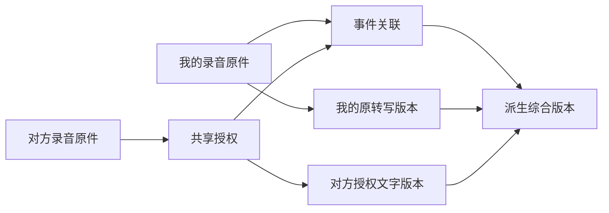

# 共享录音供 Agent 和我的一天使用的接入与后端交接

共享应让接收方按授权使用文字资料，包括 Agent 问答和日历回顾。当前共享的是一次冻结的文字快照；原始音频播放、下载、重新转写需要另行授权。第一阶段先接通文字读取、来源标识和撤回检查；第二阶段再识别同场录音并生成可追溯的综合版本。

本文面向 Chat、Record、Audio、Agent 和日历同事。本轮只改 Arkme 插件，复用现有 HTTP 接口；下文新增契约均为待后端评审的需求，不代表已部署功能。

## 已有后端能力与边界

核对基线：插件 origin/dev `eb364395`，Chat master `ca502494`，Audio master `cd27b15`。这些代码及已有测试提供实现依据，不代表本轮完成线上跨账号验收。

| 环节 | 已有行为 | 边界 |
| --- | --- | --- |
| Audio 共享票据 | 根据录音来源和对方身份生成能力票据，服务间换取标题、摘要、全文、参与者和录音发生时间 | 不包含原始音频资源，也不把对方加入 Audio 所有权 |
| Chat 接收共享 | 创建 Record 正文及私聊关系，发送消息和通知，重复共享当前有效来源保持幂等 | 属于冻结快照；后续修改原转写不会自动修改旧共享 |
| 双方首页和日历 | Chat 创建参与者可见投影；按录音发生时间归日，受隐私锁和首页可见性影响 | 不是导入接收方的本人音频覆盖或转写存储 |
| 撤回 | 撤销共享关系，日历、首页和相关录音列表随权限收敛，原记录保留 | 尚需跨端失效事件、索引和派生结果联动验收 |
| 全文读取 | 列表只给摘要；单条 `/api/v1/chats/records/detail` 经过关系权限检查后读取共享全文 | 不应从列表“没有 transcript”推断没有文字 |
| 相同时段 | 自己的 Audio 时段和收到的共享条目分别排序 | 没有同场识别、跨录音去重或转写融合 |

代码位置：

- Audio `gin/api/audio_related_recording_share_ticket.go`：票据和文字快照；`source_digest` 基于 owner、counterpart、moment 身份，**不是音频内容指纹**。
- Chat `gin/api/chat_shared_recording.go`：接收、撤回、全文快照和发生时间。
- Chat `gin/api/chat_related_recording_page.go`：本人来源与共享关系各自独立的身份和排序。
- Chat `internal/chat/mutation.go`：双方首页和日历投影；`repository.go`：单条详情授权后允许全文。
- Chat `test/e2e/shared_recording_completion_test.go`、`shared_recording_calendar_recovery_test.go`：已有首页、日历、隐私锁、恢复和撤回测试。
- Audio `gin/api/audio_my_day.go`：本人音频覆盖、转写按当前账号读取。

## 本轮插件接入

### Agent

新增只读工具 `arkme_shared_recording_read`，与现有相关录音、私聊读取和按日记录工具配合：

1. `arkme_related_recordings_read` 返回接收到的条目的 `sharedRecordingDetailRef`；私聊及日历可返回 `content.sharedRecording.detailRef`。
2. Agent 原样传入 `detail_ref`，读取一份共享文字快照。每次经 Host 校验账号绑定，并请求现有 Chat 详情接口检查当前关系权限。
3. 默认返回 4000 个 Unicode 字符，最大 8000；超过时返回 `hasMore` 和 `next_offset`，继续读取可以覆盖全文。空转写明确返回不可用，摘要不能冒充全文。
4. 返回来源摘要标识、共享人 ID、发生起止时间和共享时间。工具不能共享、撤回、播放原音频或重转写。

工具不建立持久全文缓存或向量索引。Agent 可以围绕用户任务按需读取；全文检索、跨全部联系人召回、自动长期记忆，以及其它端 Agent 的工具注册仍需对应服务完成。

### 我的一天

- 复用 `/api/v1/calendar/records/query` 的可见记录投影，保留共享录音结构和账号绑定的详情引用。兼容 Record 的 `payload_kind=1 / schema_version=1 / text_state=1 / shared_recording` 规范正文及 Chat 展示结构，不能要求 Record 正文携带仅属于关系的 `render_kind`。
- 共享条目归入“录音”筛选，按原始发生时间排列，显示“某人共享的录音”或“我的共享录音”和“共享文字”。资料存在不等于接收方本人参加了该事件。
- 本人音频和共享文字独立呈现，不根据同时段、标题或相同文本自动合并。概览分别统计本人录音时段和共享文字份数；共享条目不加入 Audio 物理覆盖。
- 展开时重新读取权限内的全文，不依赖日历列表中的截断文本。缺少详情引用时明确提示到原对话查看，不编造可用入口。
- 分享和撤回后触发现有 Record 投影失效，刷新本地日历数据。

日历目前只查询已选择日期并按现有游标分页。没有共享投影、接口未部署、首页隐藏或隐私锁导致不可见时，不会通过扫描所有私聊绕过这一边界。跨日时段如何投影到每个重叠日，仍由后端日历归日契约决定；插件不补造其它日期数据。

### 当天 AI 小结

用户点击生成时，先重新读取已加载共享条目的授权文字，展示此次摘录和来源；确认生成前再复核。撤回、详情失败或来源不一致时停止生成，不把旧摘要作为兜底发送。

仍限最多 24 段、合计 6000 字符。共享文字每份最多取开头 1200 字符，其它活动预览最多 240 字符；达到总预算后停止纳入。界面明确是摘录，**不能代表完整全天总结**。全文问答应由 Agent 分段读取需要的原文。

模型输入只带显示时间、类型、标题、文字和范围说明。签名引用、内部 ID、位置字段、原始音视频不进入模型输入。链接和明确坐标对沿用现有脱敏；正文里的其它个人信息仍通过摘录审阅交由用户决定。

每次使用前复核可以阻止已撤回内容再次读取或生成，但不能抹除人已经阅读、下载或 Agent 已经输出的内容。撤回与进行中生成请求之间的竞态、对端仍打开的页面和已有派生内容，要通过下述服务端权限版本和失效机制进一步收敛。

## 后端第一阶段待接续

先以两个测试账号逐条验收现有接口，再确定需要补充的契约。不要另建绕过原 Chat 关系授权的全文读取入口。

| 责任域 | 需要提供或确认 | 验收重点 |
| --- | --- | --- |
| Chat 和 Record | 日历返回可识别共享类型、record owner、原会话来源及有效共享关系；发生时间和归日规则稳定 | 接收方日历可发现，详情拒绝已撤回关系；隐私锁和首页隐藏规则一致 |
| Agent 服务 | 将当前可见共享来源纳入按日期和关键词检索，可沿同一来源分页获取全文 | 不只检索标题摘要；每次检索和详情复查权限，不把工具参数直接当访问权 |
| Chat 和事件服务 | 分享、撤回、删除、隐私变化、重新共享产生可消费的增量失效事件及权限版本 | 去重、乱序、重放、断线重连不复活旧授权 |
| Agent 索引和缓存 | 索引标注 owner、recipient、有效 grant、来源和权限版本 | 撤权后立即停止召回；生成前再校验，不能只在写入索引时判断权限 |
| 日历和回顾 | 派生小结保存所依赖的共享来源和版本，支持失效和重算 | 撤回其中一份来源后旧综合结论失效，不残留已撤回片段 |
| 音频授权 | 文本读取与原始音频播放、下载、重转写分开授权 | 无音频授权时不能以共享正文中的链接绕过访问控制 |

建议补充的**领域字段，名称待同事确认**：

- 来源：`source_id`、`owner_id`、`recording_id`（服务端可见）、发生起止时间、时区、正文版本。
- 授权：`grant_id`、接收者、状态、`access_version`、文本可读、音频可播、可重转写；必要时按片段范围收窄。
- 引用：客户端只接收可授权读取的公开来源标识和不透明引用，不暴露存储桶直链或内部音频 session。
- 检索结果：原文片段、来源版本、发生时间、共享人、权限版本、明确的截断和分页信息。
- 失效事件：唯一事件 ID、受影响授权和版本、撤回或内容更新原因；客户端按版本单调前进。

## 第二阶段 同场识别与多录音综合

### 数据分层

源录音、共享授权、事件关联、派生综合版本分别保存。原始转写不可被综合结果覆盖；撤回撤销访问和派生依赖，不删除另一个人自己的原始录音。

### 识别规则

1. 同一份源录音的重复传输用稳定来源 ID、文件哈希或分段哈希去重；当前 `source_digest` 只解决共享身份幂等，不可用作音频相似度依据。
2. 同一时间不同内容保留为不同事件；仅时间重叠不足以判定同场。
3. 同一会议不同设备用发生时间候选、实际重叠区间、文字相似、参与者等证据提议关联。原始音频已授权时可增加声学指纹证据；无法确认时保持独立，提供“可能同场”提示供用户核对。
4. 部分重叠只对齐交集，保留各自独有的开头和结尾；考虑设备时间误差、时钟漂移、停录和分段。
5. 每份源录音的说话人编号独立。“speaker 1”不天然是同一个人；真实联系人匹配需要明确身份依据。

### 综合版本

- 文字层的比较只能补充或提示差异；没有原始音频时不能宣称完成声学纠错。
- 每个综合片段保留原文、源录音、版本、起止时间和引用；标注一致、互补、冲突或不确定。
- 数字、姓名、否定词等冲突保留两种证据或待确认标记，不以模型选出的“更通顺”句子当作真实结论。
- 使用原音频重转写前核对范围授权；记录模型版本、参数、处理时间和输入时长。
- 派生版本保存依赖和权限版本。源内容修订生成新版本；撤权后剔除相应证据并重算，旧综合版本不得继续暴露撤回文字。

已确认的后续交互方向：同场事件下提供“综合整理 / 我的版本 / 对方的版本”、原文依据和差异。当前插件没有创建无后端支撑的融合按钮，也没有把同时间记录拼成假综合版本。

### 成本与时长口径

一个事件持续一小时、两个设备各录一小时：事件覆盖为一小时，原始音频总时长为两小时；如果两份都投入模型，转写输入为两小时。共享文本自身不再产生一次原音频转写费用。事件覆盖、存储量、模型输入时长和综合文本处理量需分别计量。

## 联调验收清单

- A 向 B 共享；B 私聊卡片、相关录音、对应日期日历可见；Agent 在自身账号读取超过 8000 字符的全文并能连续翻页。
- 分享时间晚于录音日期；日历仍在约定的发生日期；验证本地时区、跨午夜和夏令时边界。
- B 无本人录音也能读取 A 的授权文字；存在同时段本人录音时，两者分别标来源，不能重复计入本人音频覆盖或存储。
- A 撤回后 B 的旧详情引用失效；准备小结后再撤回，确认生成不得使用旧摘录。
- A 撤回后重新共享产生新关系；旧引用仍失效。重复点击和请求重试不生成重复共享记录。
- 验证切换账号、离开日期、取消读取后在途响应不会显示到新页面。
- 验证隐私锁、首页隐藏、本人删除及恢复和 Chat 关系访问权的差异；不可把日历展示授权等同于音频授权。
- 全文索引、长驻页面、离线缓存、Agent 长期记忆和派生综合结果分别验证撤权失效；不能只验私聊卡片消失。
- 真正的综合能力需额外样本：两份完全相同、同场不同设备、仅部分重叠、同时不同场、说话人编号冲突、数字和否定词识别冲突。

本轮自动化覆盖插件映射、分段全文读取、授权失败、来源变化、日期切换、摘录预算和生成前撤回检查。真实双账号收发、服务端索引失效和多录音融合仍由联调验收完成；未发送真实录音给联系人，未修改已安装 Arkme 客户端。

## 本轮验证记录

- 全库：913 个测试文件通过，13 个跳过；10,754 项通过，17 项跳过。
- 最后的 Record 规范正文兼容及小结失败清理调整后：9 个直接相关测试文件、382 项通过。
- TypeScript 声明生成、插件构建、可执行入口检查与差异空白检查通过。
- 合成浏览器数据验证：同时间来源独立显示、共享全文展开、小结摘录审阅；没有浏览器脚本错误。
- 独立 `http://127.0.0.1:3100/` 构建已替换并核对产物，继续复用原客户端登录。真实双账号收发及撤回传播仍待联调；没有修改已安装客户端。
